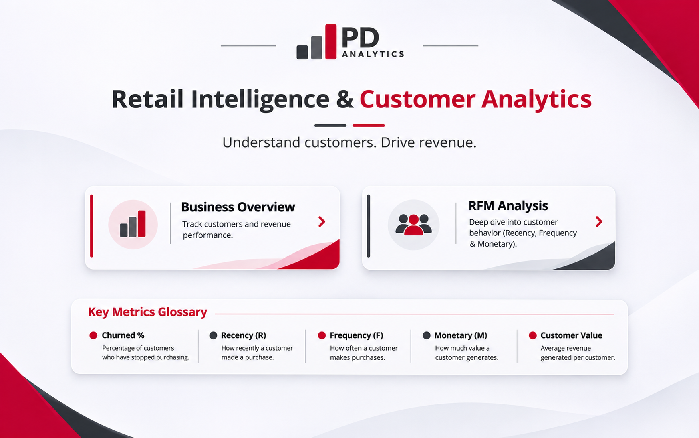
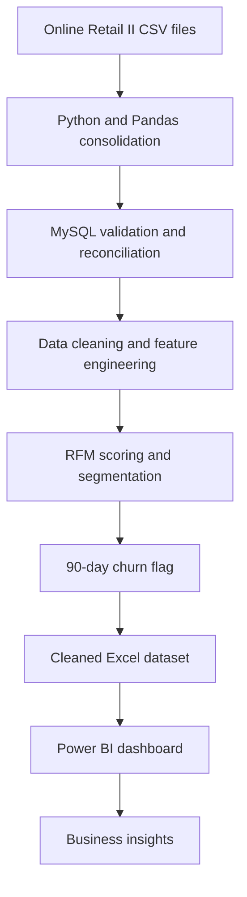
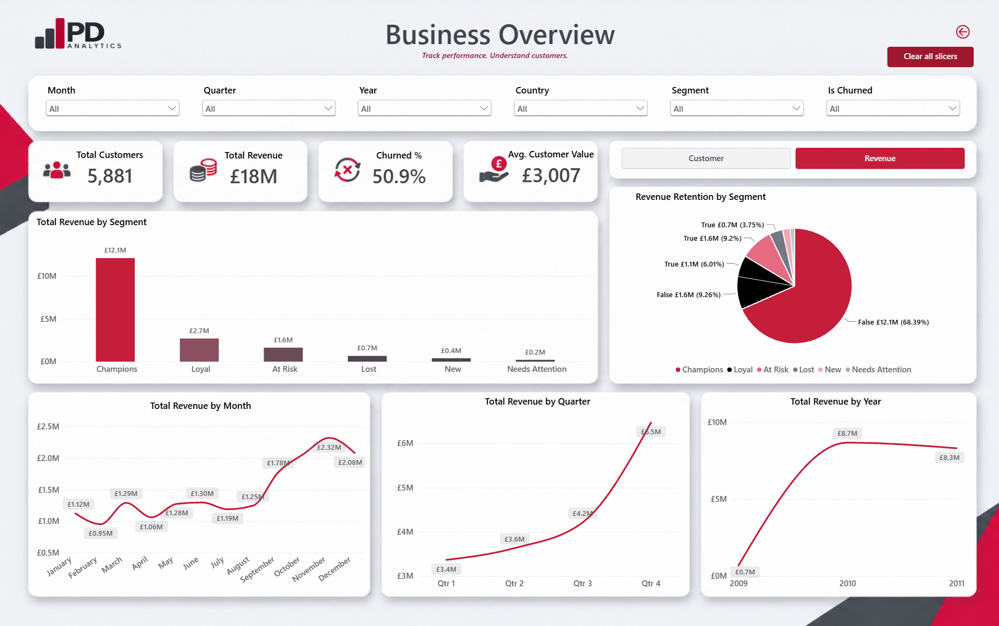
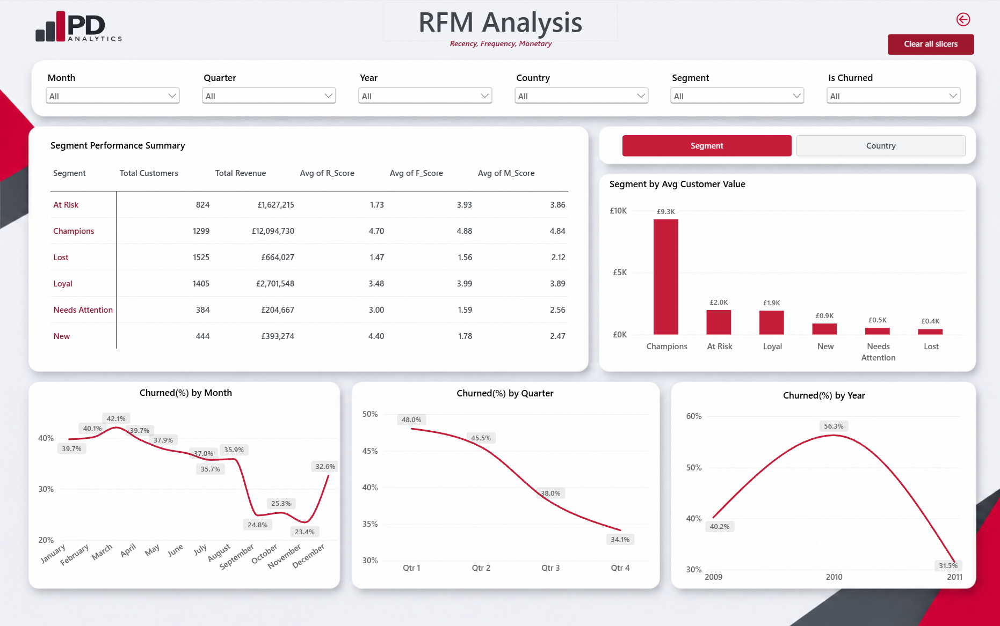

<div align="center">
  

# Retail Intelligence & Customer Analytics

**Understand customers. Drive revenue.**

*An end-to-end data analytics project by Prateek Dhall*

[](https://www.python.org/)
[](https://www.mysql.com/)
[](https://powerbi.microsoft.com/)
[](https://pandas.pydata.org/)
[](https://www.microsoft.com/microsoft-365/excel)
[](https://jupyter.org/)
[](https://www.sqlalchemy.org/)

[Overview](#-project-overview) • [Workflow](#-project-workflow) • [Dashboard](#-power-bi-dashboard) • [RFM](#-rfm-analysis) • [Author](#-author)



</div>

## 📌 Project Overview

This project transforms historical UK online retail transactions into actionable customer intelligence. It combines data consolidation, SQL-based validation, Python-based RFM segmentation and interactive Power BI reporting to understand revenue performance, customer value and churn risk.

| Raw transactions | Coverage | Customer segments |
|:---:|:---:|:---:|
| 1,067,371 | 2009–2011 | 6 |

## 🎯 Business Objectives

- Identify high-value customers and their revenue contribution.
- Understand customer purchasing behavior through RFM analysis.
- Identify inactive customers using a fixed churn threshold.
- Explore customer and revenue trends across time and markets.
- Support targeted retention and marketing decisions.

## 🛠️ Tools & Technologies

| Tool | Purpose |
|---|---|
| Python & Pandas | Consolidation, cleaning, feature engineering and segmentation |
| MySQL | Data validation, datatype conversion and duplicate removal |
| SQLAlchemy | Python-to-MySQL connectivity |
| Jupyter Notebook | Documented analytical workflow |
| Microsoft Excel | Raw and cleaned dataset storage |
| Power BI | Interactive reporting and visualization |

## 🔄 Project Workflow



## 📊 Power BI Dashboard

[Open Power BI report (.pbix)](Retail_Intelligence_Customer_Analytics.pbix) · [Business Requirements Document](PD_Analytics_BRD.pdf)

<details open>
<summary><b>01 — Landing Page</b></summary>
<br>

<p>Navigation between Business Overview and RFM Analysis, with a glossary of key metrics.</p>
</details>

<details open>
<summary><b>02 — Business Overview</b></summary>
<br>

<p>Tracks total customers, total revenue, churned percentage and average customer value.</p>
</details>

<details open>
<summary><b>03 — RFM Analysis</b></summary>
<br>

<p>Explores customer segments based on recency, frequency and monetary value.</p>
</details>

> The images above are screenshots of the completed Power BI report. Open the PBIX file in Power BI Desktop to explore the interactive report.

### Dashboard Highlights

| Total Customers | Total Revenue | Churned % | Avg Customer Value |
|:---:|:---:|:---:|:---:|
| 5,881 | £18M | 50.9% | £3,007 |

- **Champions:** 1,299 customers generating approximately £12.1M in revenue (68.39% of total revenue).
- **At Risk:** 824 customers contributing approximately £1.63M in revenue.
- **Lost:** 1,525 customers, the largest segment by customer count.
- **Revenue seasonality:** Q4 has the highest displayed quarterly revenue at approximately £6.5M.

These figures are taken from the supplied dashboard screenshots with all slicers set to All. Revenue figures are rounded where indicated.

### Key Performance Indicators

| KPI | Definition |
|---|---|
| Total Customers | Distinct customer count |
| Total Revenue | Sum of quantity × unit price (£) |
| Churned % | Percentage of customers flagged as churned |
| Avg Customer Value | Total revenue divided by total customers (£) |

## 👥 RFM Analysis

| Metric | Meaning |
|---|---|
| Recency (R) | Days since the most recent purchase |
| Frequency (F) | Number of distinct invoices |
| Monetary (M) | Total customer purchase amount |

The notebook assigns scores from 1 to 5 using quantile-based scoring. The snapshot date is one day after the latest transaction date. Customers with recency greater than 90 days are flagged as churned; this is a rule-based indicator, not a predictive model.

<details>
<summary><b>View customer segmentation rules</b></summary>

Rules are evaluated in the following order:

| Segment | Rule |
|---|---|
| Champions | R ≥ 4, F ≥ 4, M ≥ 4 |
| Loyal | R ≥ 3, F ≥ 3 |
| At Risk | R ≤ 3, F ≥ 3 |
| New | R ≥ 4, F ≤ 2 |
| Needs Attention | R = 3, F ≤ 2 |
| Lost | Remaining customers |

</details>

## 📂 Dataset

[Online Retail II — UCI Machine Learning Repository](https://archive.ics.uci.edu/dataset/502/online+retail+ii), donated by Daqing Chen. Contains 1,067,371 historical transaction records from December 2009 to December 2011.

## 📁 Repository Structure

```text
retail-intelligence-customer-analytics/
├── Dataset/
│   ├── Raw/
│   │   ├── csv/
│   │   └── xlsx/
│   └── Cleaned/
│       └── Retail_Cleaned.xlsx
├── Screenshots/
│   ├── Landing.png
│   ├── Overview.png
│   └── RFM.png
├── Theme/
│   ├── Images/
│   │   ├── Landing.png
│   │   ├── Overview.png
│   │   ├── RFM.png
│   │   └── PD Analytics Bar Chart Logo.png
│   ├── Theme.json
│   └── Cherry_Red_Graphite_PowerBI_Theme.json
├── PD_Analytics_BRD.pdf
├── Retail_Intelligence.sql
├── Retail_Intelligence_Customer_Analytics.ipynb
├── Retail_Intelligence_Customer_Analytics.pbix
└── README.md
```

## 🎨 Dashboard Theme


Canvas: **1750 × 1100 px** · Currency: **GBP (£)**

## 👨‍💻 Author

**Prateek Dhall**

[](https://www.linkedin.com/in/prateek-dhall-pd/)
[](https://github.com/pdhall-us)